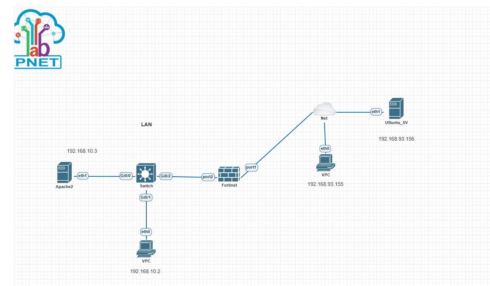

# FortiGate Lab: DNAT Port Forwarding

## Scenario Overview



This lab uses a FortiGate Virtual IP (VIP) to publish an internal Apache web server. Requests sent to WAN port `8080` are forwarded to port `80` on the internal server.

> This is **not hairpin NAT**: the test client is on the WAN network and the server is on the LAN. Because they are on different subnets and the server's default gateway is the FortiGate, the server's replies naturally pass back through the FortiGate. Source NAT is not required for this topology.

## Network Topology and IP Addressing

| Device | Interface | IP address | Network |
|---|---|---:|---|
| Apache Server | `eth1` | `192.168.10.3/24` | LAN |
| LAN VPC | `eth0` | `192.168.10.2/24` | LAN |
| FortiGate | `port2` (LAN) | `192.168.10.1/24` | LAN |
| FortiGate | `port1` (WAN) | `192.168.93.154/24` | WAN |
| WAN VPC | `eth0` | `192.168.93.155/24` | WAN |
| Ubuntu Test Client | `eth1` | `192.168.93.156/24` | WAN |

## Prerequisites: Verify Network Configuration

After importing and starting the `DNAT_Lab.crdownload` lab, verify the interface and IP settings on each node. Depending on your PNETLab setup and VM images, some settings may need to be configured manually.

### 1. Configure the Apache Server

Set the server's LAN interface to `192.168.10.3/24` and its default gateway to `192.168.10.1`.

For a temporary configuration, replace `eth1` if the interface has a different name:

```bash
sudo ip addr replace 192.168.10.3/24 dev eth1
sudo ip link set eth1 up
sudo ip route replace default via 192.168.10.1
```

### 2. Configure the Ubuntu Test Client

Set the WAN-side interface to `192.168.93.156/24`. A default gateway is not required for this specific test because the client and the FortiGate WAN interface are on the same subnet.

```bash
sudo ip addr replace 192.168.93.156/24 dev eth1
sudo ip link set eth1 up
```

These `ip` commands configure the interfaces temporarily; the settings may not persist after a reboot. For persistent Ubuntu configuration, use the appropriate Netplan configuration for the installed Ubuntu version.

### 3. Configure the VPCs

On the LAN VPC:

```text
ip 192.168.10.2/24 192.168.10.1
```

On the WAN VPC:

```text
ip 192.168.93.155/24
```

### 4. Configure the FortiGate Interfaces

Configure `port1` as the WAN interface and `port2` as the LAN interface. Administrative access on the WAN interface is not required for this DNAT test.

Example CLI configuration:

```text
config system interface
    edit "port1"
        set ip 192.168.93.154 255.255.255.0
        set allowaccess ping
    next
    edit "port2"
        set ip 192.168.10.1 255.255.255.0
        set allowaccess ping
    next
end
```

> If you need GUI or SSH administration, enable it only on a trusted management interface or restrict it to trusted source addresses. Avoid exposing administrative access on the WAN interface unnecessarily.

## Objectives

1. Publish the internal Apache web server through the FortiGate.
2. Map WAN port `8080` to internal port `80`.
3. Test the connection from Ubuntu on the WAN network.

## Step 1: Set Up the Apache Web Server

Make sure Apache is running on `192.168.10.3` and that its default gateway is `192.168.10.1`.

From the LAN VPC, test local access:

```bash
curl -v http://192.168.10.3
```

To edit the default web page, if needed:

```bash
sudo nano /var/www/html/index.html
```

## Step 2: Create the DNAT VIP

In the FortiGate GUI, go to:

`Policy & Objects > Virtual IPs > Create New`

Configure the VIP as follows:

- **Name:** `Apache_DNAT`
- **Interface:** `port1`
- **External IP:** `192.168.93.154`
- **Port Forwarding:** Enabled
- **Protocol:** TCP
- **External Service Port:** `8080`
- **Map to Port:** `80`
- **Mapped IP:** `192.168.10.3`

CLI equivalent:

```text
config firewall vip
    edit "Apache_DNAT"
        set extip 192.168.93.154
        set extintf "port1"
        set portforward enable
        set protocol tcp
        set extport 8080
        set mappedip "192.168.10.3"
        set mappedport 80
    next
end
```

This VIP translates traffic destined for `192.168.93.154:8080` to `192.168.10.3:80`. The FortiGate VIP performs destination NAT; the firewall policy controls whether the traffic is allowed.

## Step 3: Create the Firewall Policy

This policy allows TCP traffic arriving at the VIP on `port1` to reach the LAN server through `port2`.

In the FortiGate GUI, go to:

`Policy & Objects > Firewall Policy > Create New`

Configure the policy as follows:

- **Incoming Interface:** `port1`
- **Outgoing Interface:** `port2`
- **Source:** `all` (for this lab; in production, restrict this to permitted source IPs where possible)
- **Destination:** `Apache_DNAT` (the VIP)
- **Service:** `HTTP`
- **Action:** `ACCEPT`
- **NAT:** Disabled

CLI equivalent:

```text
config firewall policy
    edit 0
        set name "WAN_to_LAN_DNAT"
        set srcintf "port1"
        set dstintf "port2"
        set srcaddr "all"
        set dstaddr "Apache_DNAT"
        set action accept
        set schedule "always"
        set service "HTTP"
        set nat disable
    next
end
```

The policy uses the VIP as its destination. NAT is disabled so the Apache server receives the client's original source IP address. The `HTTP` service limits the policy to the server's mapped destination port, TCP/80.

> If the FortiGate is configured for Central NAT, VIP and firewall policy behavior may differ. CLI options and GUI labels can also vary by FortiOS version.

## Step 4: Test the Connection

From the Ubuntu test client on the WAN network, run:

```bash
curl -v http://192.168.93.154:8080
```

If successful, you should receive a response similar to:

```text
< HTTP/1.1 200 OK
< Server: Apache/2.4.41 (Ubuntu)
< Content-Type: text/html

Web Server is running
```

## Troubleshooting Checklist

- Confirm Apache is running and listening on `192.168.10.3:80`.
- Confirm the Apache server's default gateway is `192.168.10.1`.
- Confirm the FortiGate interfaces have the expected IP addresses and are up.
- Confirm the policy's incoming interface is `port1` and its outgoing interface is `port2`.
- Confirm the policy destination is the VIP, `Apache_DNAT`, not the server's address object.
- Confirm the policy service allows HTTP (TCP port `80` after DNAT).
- Confirm the VIP maps external TCP port `8080` to internal TCP port `80`.
- Keep policy NAT disabled for this topology if the server should see the client's original IP address.

## Lab Files

- [`DNAT_Lab.crdownload`](./DNAT_Lab.crdownload) — PNETLab topology file. Verify node configuration after importing; configure IPs manually if they were not retained.
- [`topology.png`](./topology.png) — Network diagram.

## Security Note

This configuration makes the web server reachable from the WAN network. In a production environment, restrict permitted source addresses where possible, allow only the required services and ports, and use HTTPS rather than unencrypted HTTP.
